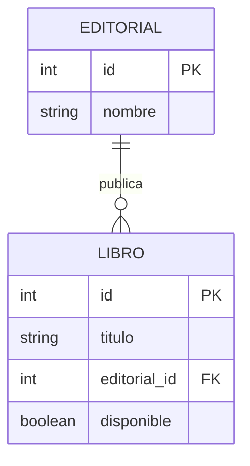

# UT4 · Bloque 1. Persistencia de datos y bases de datos en Django


## Objetivos

- Comprender la persistencia de información en aplicaciones web.
- Identificar los elementos de una base de datos relacional.
- Reconocer los gestores de bases de datos compatibles con Django.
- Configurar y explorar una base de datos SQLite en Django.

## 1. Persistencia de información en aplicaciones web

La **persistencia** permite conservar información después de que finalice la ejecución de una aplicación. Los datos almacenados únicamente en variables se pierden al terminar el proceso.

```python
libros = [
    {"titulo": "El Quijote", "autor": "Cervantes"},
    {"titulo": "1984", "autor": "George Orwell"},
]
print(libros)
```

En una aplicación web es necesario mantener datos entre peticiones HTTP y permitir que varios usuarios accedan a la misma información.

| Mecanismo | Características | Ejemplos |
|---|---|---|
| Archivos de texto | Datos simples | `.txt` |
| Archivos estructurados | Datos organizados en un formato | `.json`, `.csv` |
| Bases de datos | Consultas, modificaciones y relaciones | SQLite, PostgreSQL, MySQL |

## 2. Bases de datos relacionales

Una base de datos relacional organiza la información en **tablas**. Cada **fila** es un registro y cada **columna** representa un campo.

| id | titulo | isbn | disponible |
|---:|---|---|---|
| 1 | El Quijote | 9788420412146 | Sí |
| 2 | 1984 | 9788499890944 | No |
| 3 | La sombra del viento | 9788408172178 | Sí |

- **Clave primaria (PK):** identifica de manera única cada registro.
- **Clave foránea (FK):** referencia un registro de otra tabla.
- **Relación:** vincula datos de diferentes tablas y ayuda a evitar duplicidades.

Ejemplo: una editorial puede publicar muchos libros; cada libro pertenece a una editorial en este modelo inicial.



> El diagrama anticipa el concepto de relación; su implementación con Django se estudiará en un bloque posterior.

## 3. Sistemas gestores de bases de datos

| SGBD | Características |
|---|---|
| SQLite | Base de datos en un archivo; no necesita servidor independiente |
| PostgreSQL | Gestor relacional avanzado, habitual en aplicaciones web |
| MySQL | Gestor relacional ampliamente utilizado |
| MariaDB | Gestor compatible con gran parte del ecosistema MySQL |

Empezaremos con **SQLite**, que Django configura por defecto al crear un proyecto.

## 4. Configuración de la base de datos en Django

En `biblioteca/settings.py`, Django define la conexión mediante `DATABASES`:

```python
DATABASES = {
    "default": {
        "ENGINE": "django.db.backends.sqlite3",
        "NAME": BASE_DIR / "db.sqlite3",
    }
}
```

- `default`: nombre de la conexión principal.
- `ENGINE`: gestor de base de datos.
- `NAME`: ubicación del archivo SQLite.

## 5. Demostración guiada

> Requisito previo: tener Python y Django instalados y disponer de un entorno virtual activado.

Crear el proyecto y la aplicación:

```bash
django-admin startproject biblioteca
cd biblioteca
python manage.py startapp catalogo
```

Registrar `catalogo` en la lista `INSTALLED_APPS` de `biblioteca/settings.py`:

```python
INSTALLED_APPS = [
    "django.contrib.admin",
    "django.contrib.auth",
    "django.contrib.contenttypes",
    "django.contrib.sessions",
    "django.contrib.messages",
    "django.contrib.staticfiles",
    "catalogo",
]
```

Aplicar las migraciones iniciales:

```bash
python manage.py migrate
```

Esto crea `db.sqlite3` y las tablas necesarias para las aplicaciones internas de Django (usuarios, permisos, sesiones, etc.). Abrir el archivo con **DB Browser for SQLite** y explorar su estructura.

## 6. Actividad 1. Exploración de la base de datos

**Objetivo:** comprender cómo Django almacena información.

1. Crear el proyecto `biblioteca` y la aplicación `catalogo`.
2. Registrar `catalogo` en `INSTALLED_APPS`.
3. Localizar y explicar la configuración `DATABASES`.
4. Ejecutar las migraciones iniciales.
5. Abrir `db.sqlite3` con DB Browser for SQLite.
6. Identificar al menos tres tablas generadas automáticamente.
7. Examinar los campos de `auth_user`.
8. Localizar su clave primaria.

**Preguntas de reflexión:**

- ¿Por qué se crean tablas si todavía no hemos definido modelos propios?
- ¿Qué ocurriría con los datos si eliminásemos `db.sqlite3`?

**Entrega:** captura de la estructura de la base de datos y respuestas razonadas.

## Resultado esperado

Proyecto Django configurado con SQLite y comprensión básica de las tablas y su estructura.
