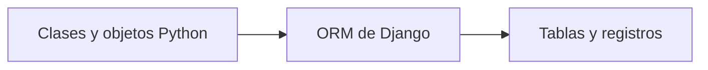

# UT4 · Bloque 2. Mapeo objeto-relacional y definición de modelos

## Objetivos

- Comprender el mapeo objeto-relacional (ORM) de Django.
- Definir modelos Django.
- Seleccionar tipos de campos y restricciones adecuados.
- Personalizar la representación y el orden de los modelos.

## 1. ¿Qué es un ORM?

**ORM** significa *Object-Relational Mapping* (mapeo objeto-relacional). Permite trabajar con registros de una base de datos mediante clases y objetos Python, sin escribir manualmente las consultas SQL habituales.



Por ejemplo:

```python
Libro.objects.filter(disponible=True)
```

Equivale conceptualmente a una consulta SQL similar a:

```sql
SELECT * FROM catalogo_libro WHERE disponible = 1;
```

El ORM genera SQL adaptado al gestor configurado.

| Programación orientada a objetos | Base de datos relacional |
|---|---|
| Clase | Tabla |
| Atributo del modelo | Columna |
| Instancia | Registro |
| Identificador | Clave primaria |
| Relaciones entre objetos | Relaciones entre tablas |

## 2. Definición de modelos

En Django, cada modelo se define como una clase que hereda de `models.Model`. En `catalogo/models.py`:

```python
from django.db import models

class Libro(models.Model):
    titulo = models.CharField(max_length=200)
    isbn = models.CharField(max_length=13)
    paginas = models.PositiveIntegerField()
    precio = models.DecimalField(max_digits=8, decimal_places=2)
    disponible = models.BooleanField(default=True)

    def __str__(self):
        return self.titulo
```

Django añade por defecto una clave primaria `id` cuando no se define otra.

## 3. Tipos de campos

| Campo | Utilidad | Ejemplo |
|---|---|---|
| `CharField` | Texto de longitud limitada | Título |
| `TextField` | Texto largo | Sinopsis |
| `IntegerField` | Entero | Año |
| `PositiveIntegerField` | Entero no negativo | Páginas |
| `DecimalField` | Decimal de precisión fija | Precio |
| `FloatField` | Coma flotante | Medición |
| `BooleanField` | Verdadero/falso | Disponible |
| `DateField` | Fecha | Publicación |
| `DateTimeField` | Fecha y hora | Registro |
| `EmailField` | Correo electrónico | Email |
| `URLField` | Dirección web | Sitio web |
| `ImageField` | Referencia a imagen | Portada |

`ImageField` requiere Pillow.

## 4. Restricciones y opciones

```python
class Libro(models.Model):
    titulo = models.CharField(max_length=200)
    isbn = models.CharField(max_length=13, unique=True)
    descripcion = models.TextField(blank=True)
    precio = models.DecimalField(max_digits=8, decimal_places=2, default=0)
    disponible = models.BooleanField(default=True)
```

| Opción | Función |
|---|---|
| `max_length` | Longitud máxima |
| `null=True` | Permite `NULL` en la base de datos |
| `blank=True` | Permite valor vacío durante la validación |
| `unique=True` | Impide valores duplicados |
| `default` | Valor predeterminado |
| `primary_key=True` | Define clave primaria |
| `choices` | Define valores disponibles para la validación |

**Importante:** `null` afecta al almacenamiento; `blank` afecta a la validación. No todas las restricciones se aplican directamente por el motor de base de datos: algunas dependen de la validación de Django.

## 5. Representación de objetos y clase Meta

`__str__()` define la representación legible de un objeto:

```python
def __str__(self):
    return self.titulo
```

En lugar de `Libro object (1)`, podremos ver `El Quijote`.

La clase `Meta` permite establecer opciones del modelo:

```python
class Libro(models.Model):
    titulo = models.CharField(max_length=200)
    precio = models.DecimalField(max_digits=8, decimal_places=2)

    class Meta:
        ordering = ["titulo"]
        verbose_name = "Libro"
        verbose_name_plural = "Libros"
```

## 6. Actividad 2. Creación de modelos Django

**Objetivo:** crear modelos con tipos de campos y restricciones adecuados.

En la aplicación `catalogo`, definir **tres modelos independientes**, todavía sin relaciones.

### Modelo Autor

| Campo | Tipo | Restricciones |
|---|---|---|
| nombre | `CharField` | Máximo 100 caracteres |
| apellidos | `CharField` | Máximo 150 caracteres |
| fecha_nacimiento | `DateField` | Opcional (`null=True, blank=True`) |
| nacionalidad | `CharField` | Máximo 50 caracteres |
| biografia | `TextField` | Opcional (`blank=True`) |

### Modelo Editorial

| Campo | Tipo | Restricciones |
|---|---|---|
| nombre | `CharField` | Máximo 150 caracteres, único |
| email | `EmailField` | Opcional (`blank=True`) |
| sitio_web | `URLField` | Opcional (`blank=True`) |
| activa | `BooleanField` | `default=True` |

### Modelo Libro

| Campo | Tipo | Restricciones |
|---|---|---|
| titulo | `CharField` | Máximo 200 caracteres |
| isbn | `CharField` | Máximo 13 caracteres, único |
| sinopsis | `TextField` | Opcional (`blank=True`) |
| fecha_publicacion | `DateField` | Obligatorio |
| paginas | `PositiveIntegerField` | Obligatorio |
| precio | `DecimalField` | `max_digits=8`, `decimal_places=2` |
| disponible | `BooleanField` | `default=True` |

**Tareas adicionales:**

1. Incorporar `__str__()` a los tres modelos.
2. Configurar el orden predeterminado de libros y autores mediante `Meta`.
3. Explicar por qué se ha elegido cada tipo de campo.

**Entrega:** archivo `catalogo/models.py` con las tres clases. No crear todavía relaciones entre modelos; se estudiarán más adelante.

## Resultado esperado

Tres modelos Django definidos con campos, restricciones y representación legible, preparados para generar sus migraciones.
