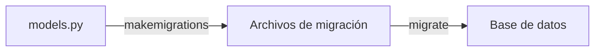

# UT4 · Bloque 3. Creación y aplicación de migraciones

**Duración:** 2 horas  
**Distribución:** Teoría (30 min), demostración (35 min), práctica (55 min).

## Objetivos

- Comprender el propósito del sistema de migraciones de Django.
- Generar y aplicar migraciones.
- Consultar el estado y el SQL de una migración.
- Modificar modelos sin perder los datos existentes.

## 1. ¿Qué son las migraciones?

Definir un modelo en Python **no crea automáticamente** una tabla. Django utiliza **migraciones**: archivos Python que describen cambios en el esquema de la base de datos (crear tablas, añadir campos, modificar restricciones, etc.).



## 2. Generar migraciones

Desde el directorio que contiene `manage.py`:

```bash
python manage.py makemigrations
```

Django detecta cambios en los modelos y crea archivos similares a:

```text
catalogo/
└── migrations/
    ├── __init__.py
    └── 0001_initial.py
```

La primera migración suele incluir operaciones `CreateModel` para las tablas iniciales.

## 3. Aplicar migraciones

```bash
python manage.py migrate
```

Este comando ejecuta las operaciones pendientes y registra las migraciones aplicadas.

| Comando | Función |
|---|---|
| `makemigrations` | Genera archivos que describen los cambios |
| `migrate` | Aplica los cambios a la base de datos |
| `showmigrations` | Muestra el estado de las migraciones |
| `sqlmigrate` | Muestra el SQL asociado a una migración |

## 4. Consultar el estado y el SQL

```bash
python manage.py showmigrations catalogo
```

Salida de ejemplo:

```text
catalogo
 [X] 0001_initial
```

`[X]` significa aplicada; `[ ]` significa pendiente.

Para ver el SQL generado:

```bash
python manage.py sqlmigrate catalogo 0001
```

## 5. Modificar modelos existentes

Supongamos que queremos añadir al modelo `Libro` un campo que indique si está recomendado. **Añadir el campo a la clase existente** (sin borrar sus otros campos):

```python
recomendado = models.BooleanField(default=False)
```

Después:

```bash
python manage.py makemigrations
python manage.py migrate
```

Django puede generar un archivo similar a `0002_libro_recomendado.py`. El valor predeterminado permite asignar un valor a los registros existentes.

### Campos nuevos obligatorios

Si añadimos a una tabla con datos un campo obligatorio sin valor predeterminado:

```python
idioma = models.CharField(max_length=30)
```

Django necesitará saber qué valor utilizar para los registros ya almacenados. Una solución es definir:

```python
idioma = models.CharField(max_length=30, default="Español")
```

También es posible proporcionar un valor puntual cuando `makemigrations` lo solicite.

## 6. Buenas prácticas

- Generar migraciones después de cambios relevantes en los modelos.
- Revisar las migraciones antes de aplicarlas.
- Mantener los archivos de migración en el repositorio Git.
- Evitar modificar migraciones ya aplicadas sin comprender sus consecuencias.
- No eliminar la base de datos como solución habitual a errores.
- Verificar que los cambios conservan los datos existentes.

## 7. Actividad 3. Gestión de migraciones

**Objetivo:** generar, aplicar y comprobar migraciones sobre los modelos del bloque anterior.

1. Ejecutar `makemigrations` y examinar el archivo generado.
2. Ejecutar `migrate` y comprobar que se han creado las tablas.
3. Utilizar `showmigrations` para verificar su estado.
4. Utilizar `sqlmigrate` para examinar las instrucciones SQL.
5. Añadir a `Libro` un campo `recomendado` de tipo booleano con `default=False`.
6. Generar y aplicar la nueva migración.
7. Añadir a `Editorial` un campo `pais` de tipo `CharField`, con longitud máxima y valor predeterminado.
8. Generar y aplicar otra migración.
9. Comprobar en DB Browser for SQLite que aparecen los nuevos campos.

**Preguntas de reflexión:**

- ¿Cuál es la diferencia entre generar y aplicar una migración?
- ¿Por qué Django puede pedir un valor predeterminado al añadir un campo obligatorio?
- ¿Qué información proporciona `showmigrations`?

**Entrega:** `models.py`, archivos de migración y capturas de su aplicación.

## Resultado esperado

Tablas creadas a partir de los modelos y cambios posteriores aplicados mediante migraciones, sin necesidad de reconstruir la base de datos.
