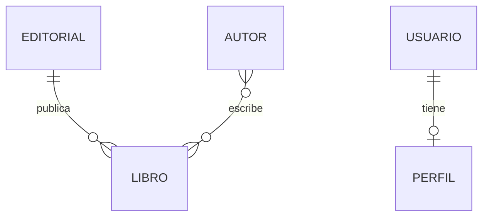

# Bloque 6. Relaciones entre modelos Django

**UT4 · Persistencia: bases de datos y ORM**  
**Duración:** 3 horas  
**Requisitos:** modelos `Libro`, `Autor` y `Editorial` de los bloques anteriores; migraciones aplicadas.

## Objetivos

- Diferenciar relaciones uno a uno, uno a muchos y muchos a muchos.
- Definir relaciones con `OneToOneField`, `ForeignKey` y `ManyToManyField`.
- Consultar objetos relacionados en ambas direcciones.
- Comprender el papel de `on_delete` y `related_name`.

## 1. Relaciones en una base de datos relacional

Una relación conecta registros de tablas diferentes. Django representa esas conexiones mediante campos especiales.



- **Uno a muchos (1:N):** una editorial publica muchos libros; cada libro pertenece a una editorial.
- **Muchos a muchos (N:M):** un autor puede escribir varios libros y un libro puede tener varios autores.
- **Uno a uno (1:1):** un usuario puede tener un perfil asociado y cada perfil corresponde a un único usuario.

## 2. Relación uno a muchos: ForeignKey

En `catalogo/models.py`, el modelo `Editorial` debe estar definido antes de utilizarlo o referenciarse por su nombre como cadena.

```python
class Editorial(models.Model):
    nombre = models.CharField(max_length=150, unique=True)
    # Conserva los demás campos del bloque 2

    def __str__(self):
        return self.nombre
```

Añade a **tu modelo `Libro` existente** el siguiente campo, sin borrar los demás:

```python
editorial = models.ForeignKey(
    Editorial,
    on_delete=models.PROTECT,
    related_name="libros",
    null=True,
    blank=True,
)
```

Se usa `null=True, blank=True` inicialmente para poder migrar los libros ya creados. Una vez asignada una editorial a todos, puede estudiarse una migración posterior para hacer la relación obligatoria.

`on_delete=models.PROTECT` impide eliminar una editorial mientras existan libros asociados. `related_name="libros"` permite acceder a los libros desde una editorial.

## 3. Relación muchos a muchos: ManyToManyField

Añade a `Libro`:

```python
autores = models.ManyToManyField(
    "Autor",
    related_name="libros",
    blank=True,
)
```

Django creará una tabla intermedia para almacenar las asociaciones. `blank=True` permite que la relación esté inicialmente vacía durante la validación.

## 4. Relación uno a uno: OneToOneField

Añade un nuevo modelo `PerfilUsuario`:

```python
from django.conf import settings
from django.db import models

class PerfilUsuario(models.Model):
    usuario = models.OneToOneField(
        settings.AUTH_USER_MODEL,
        on_delete=models.CASCADE,
        related_name="perfil",
    )
    telefono = models.CharField(max_length=20, blank=True)
    observaciones = models.TextField(blank=True)

    def __str__(self):
        return f"Perfil de {self.usuario}"
```

`CASCADE` hace que, si se elimina el usuario, se elimine también su perfil. El modelo `User` de Django se utiliza como ejemplo de entidad asociada.

## 5. Generar y aplicar las migraciones

```bash
python manage.py makemigrations catalogo
python manage.py migrate
```

Revisa las operaciones creadas. Si añades una relación obligatoria a una tabla con datos, Django puede pedir un valor para los registros anteriores: por eso el ejemplo de `editorial` comienza siendo opcional.

## 6. Crear y relacionar objetos

En Django Shell:

```python
from catalogo.models import Autor, Editorial, Libro

editorial = Editorial.objects.create(nombre="Editorial Ejemplo")
autor = Autor.objects.create(
    nombre="Ana", apellidos="López", nacionalidad="Española"
)

# Asociar a un libro que ya existe
libro = Libro.objects.first()
libro.editorial = editorial
libro.save()
libro.autores.add(autor)
```

Si ya existe una editorial con ese nombre, recupera la existente en vez de crearla de nuevo (el campo `nombre` es único).

## 7. Consultas sobre relaciones

```python
# Acceso directo desde un libro
libro.editorial
libro.autores.all()

# Acceso inverso
editorial.libros.all()
autor.libros.all()

# Filtrar a través de relaciones
Libro.objects.filter(editorial__nombre="Editorial Ejemplo")
Libro.objects.filter(autores__apellidos__icontains="López").distinct()

# Contar libros por editorial
from django.db.models import Count
Editorial.objects.annotate(total_libros=Count("libros"))
```

`distinct()` evita duplicados cuando una consulta con relaciones muchos a muchos puede devolver varias filas correspondientes al mismo libro.

## 8. Integridad referencial y eliminación

| Opción `on_delete` | Comportamiento |
|---|---|
| `CASCADE` | Elimina objetos dependientes cuando se elimina el relacionado |
| `PROTECT` | Impide la eliminación si existen referencias |
| `SET_NULL` | Pone la relación a `NULL` (requiere `null=True`) |
| `RESTRICT` | Restringe la eliminación según las reglas de Django |

**Atención:** `on_delete` es comportamiento aplicado por el ORM de Django; no debe confundirse sin más con una cláusula SQL `ON DELETE` generada por la base de datos.

## Demostración guiada (50 min)

1. Dibujar las tres cardinalidades.
2. Añadir `editorial`, `autores` y `PerfilUsuario`.
3. Generar y aplicar migraciones.
4. Crear una editorial y un autor; asociarlos a un libro existente.
5. Realizar consultas directas e inversas.
6. Intentar eliminar una editorial con libros y explicar `PROTECT`.

## Actividad 6. Catálogo de modelos relacionados (100 min)

**Enunciado:** Amplía el proyecto `biblioteca` para gestionar las relaciones entre autores, editoriales, libros y perfiles de usuario.

1. Establece una relación **1:N** entre `Editorial` y `Libro`.
2. Establece una relación **N:M** entre `Autor` y `Libro`.
3. Crea `PerfilUsuario` con relación **1:1** al usuario de Django.
4. Genera y aplica las migraciones sin perder los libros existentes.
5. Crea dos editoriales, cuatro autores y asigna relaciones a cinco libros.
6. Asocia al menos dos autores a un mismo libro.
7. Crea un usuario de prueba y su perfil (sin reutilizar contraseñas reales).
8. Recupera todos los libros de una editorial.
9. Recupera todos los libros de un autor.
10. Recupera todos los autores de un libro.
11. Muestra el número de libros por editorial mediante `annotate()`.
12. Comprueba el comportamiento de `PROTECT` al intentar eliminar una editorial con libros.

**Entrega:** `models.py`, archivos de migración, archivo con consultas ORM y diagrama de las relaciones. No se requieren vistas ni formularios web.

**Preguntas:** ¿Dónde se almacena la relación N:M? ¿Qué diferencia existe entre `ForeignKey` y `OneToOneField`? ¿Para qué sirve `related_name`?

## Distribución de las 3 horas

| Fase | Tiempo |
|---|---:|
| Explicación y diseño de relaciones | 30 min |
| Demostración guiada | 50 min |
| Actividad autónoma y puesta en común | 100 min |

## Comprobación de aprendizaje

- [ ] Identifico correctamente las tres cardinalidades.
- [ ] Defino relaciones sin perder los datos existentes.
- [ ] Creo y consulto asociaciones desde ambos extremos.
- [ ] Distingo los efectos de las opciones `on_delete`.
- [ ] Utilizo consultas ORM sobre modelos relacionados.

**Siguiente bloque:** integridad de datos y transacciones.
