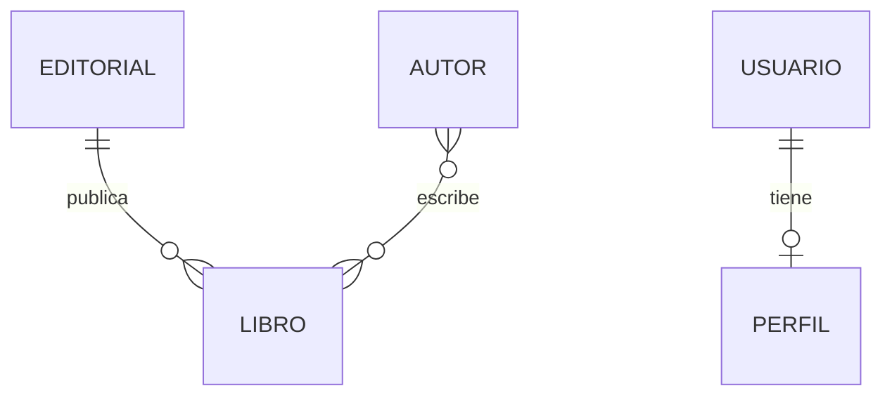
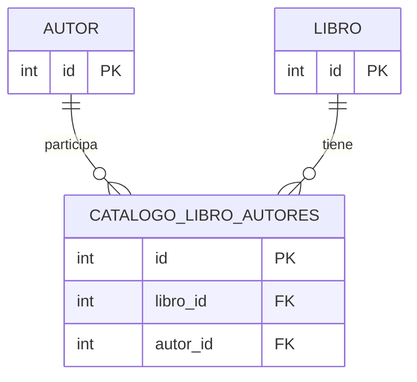
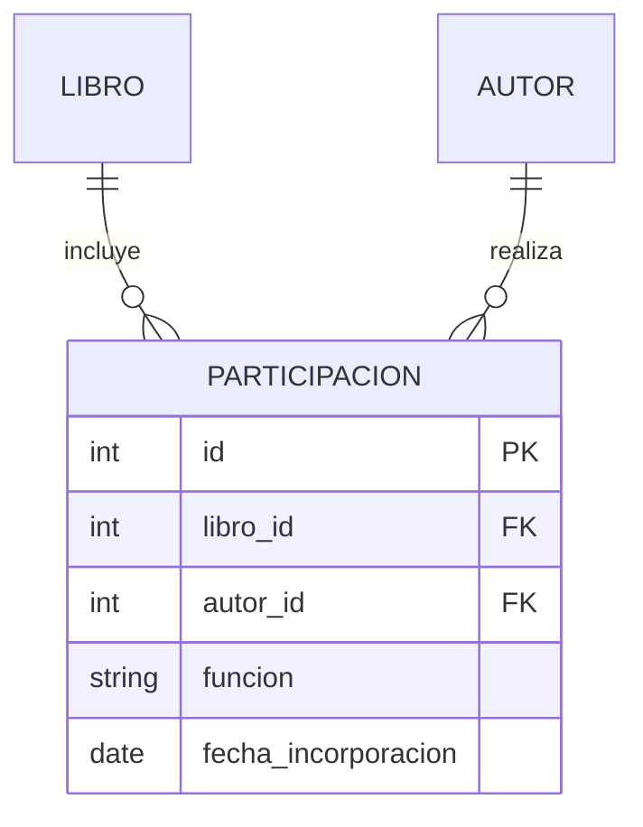

# Bloque 6. Relaciones entre modelos Django


## Objetivos

- Diferenciar relaciones uno a uno, uno a muchos y muchos a muchos.
- Definir relaciones con `OneToOneField`, `ForeignKey` y `ManyToManyField`.
- Consultar objetos relacionados en ambas direcciones mediante `related_name`.
- Optimizar la recuperación de relaciones con `select_related()`, `prefetch_related()` y `Prefetch`.
- Comprender el papel de `on_delete` y `related_name`.
- Distinguir una relación N:M automática de una relación con modelo intermedio definido mediante `through`.

## 1. Relaciones en una base de datos relacional

Una relación conecta registros de tablas diferentes. Django representa esas conexiones mediante campos especiales.



- **Uno a muchos (1:N):** una editorial publica muchos libros; cada libro pertenece a una editorial.
- **Muchos a muchos (N:M):** un autor puede escribir varios libros y un libro puede tener varios autores.
- **Uno a uno (1:1):** un usuario puede tener un perfil asociado y cada perfil corresponde a un único usuario.

## 2. Relación uno a muchos: ForeignKey

En `catalogo/models.py`, el modelo `Editorial` debe estar definido antes de utilizarlo o referenciarse por su nombre como cadena.

```python
class Editorial(models.Model):
    nombre = models.CharField(max_length=150, unique=True)
    # Conserva los demás campos del bloque 2

    def __str__(self):
        return self.nombre
```

Añade a **tu modelo `Libro` existente** el siguiente campo, sin borrar los demás:

```python
editorial = models.ForeignKey(
    Editorial,
    on_delete=models.PROTECT,
    related_name="libros",
    null=True,
    blank=True,
)
```

Se usa `null=True, blank=True` inicialmente para poder migrar los libros ya creados. Una vez asignada una editorial a todos, puede estudiarse una migración posterior para hacer la relación obligatoria.

`on_delete=models.PROTECT` impide eliminar una editorial mientras existan libros asociados. `related_name="libros"` permite acceder a los libros desde una editorial.

## 3. Relación muchos a muchos: ManyToManyField

Añade a `Libro`:

```python
autores = models.ManyToManyField(
    "Autor",
    related_name="libros",
    blank=True,
)
```

Django creará una tabla intermedia para almacenar las asociaciones. `blank=True` permite que la relación esté inicialmente vacía durante la validación.

### 3.1. ¿Qué tabla crea Django automáticamente?

Una relación N:M no se almacena en una sola columna de `Libro` ni de `Autor`. Django crea una tabla intermedia que contiene, fundamentalmente, las claves de ambos modelos:



Con esta definición, podemos añadir y consultar autores mediante `libro.autores.add(autor)` y `libro.autores.all()`. Django gestiona la tabla intermedia sin que tengamos que definir una clase para ella.

### 3.2. Relaciones muchos a muchos con `through`

A veces necesitamos guardar **datos propios de la relación**. Por ejemplo, un autor puede participar en un libro como autor principal, coautor o colaborador. Esa función pertenece a la **participación de un autor en un libro**, no al autor ni al libro por separado.

Para ello definimos un modelo intermedio y lo indicamos mediante el argumento `through` de `ManyToManyField`.

**Ejemplo alternativo al campo `autores` anterior:**

```python
class Libro(models.Model):
    # Conserva los demás campos del modelo Libro
    autores = models.ManyToManyField(
        "Autor",
        through="Participacion",
        related_name="libros",
        blank=True,
    )


class Participacion(models.Model):
    class Funcion(models.TextChoices):
        PRINCIPAL = "PRI", "Autor principal"
        COAUTOR = "COA", "Coautor"
        COLABORADOR = "COL", "Colaborador"

    libro = models.ForeignKey(
        "Libro", on_delete=models.CASCADE, related_name="participaciones"
    )
    autor = models.ForeignKey(
        "Autor", on_delete=models.CASCADE, related_name="participaciones"
    )
    funcion = models.CharField(
        max_length=3, choices=Funcion.choices, default=Funcion.COAUTOR
    )
    fecha_incorporacion = models.DateField(null=True, blank=True)

    class Meta:
        constraints = [
            models.UniqueConstraint(
                fields=["libro", "autor"], name="participacion_unica_libro_autor"
            )
        ]

    def __str__(self):
        return f"{self.autor} - {self.libro} ({self.get_funcion_display()})"
```

> **Importante:** este código es una **alternativa** al primer `ManyToManyField`, no un segundo campo `autores`. Si ya has aplicado migraciones con la tabla intermedia automática y tienes datos, **no cambies directamente** a `through` esperando que Django conserve las asociaciones: la conversión requiere una migración de datos planificada. Para practicarlo, utiliza una copia del proyecto anterior a esa migración o crea una relación nueva con otro nombre.

La relación queda representada así:



### 3.3. Crear y consultar relaciones con `through`

Una vez generadas y aplicadas las migraciones de esta **variante**, podemos crear participaciones desde Django Shell:

```python
from catalogo.models import Libro, Autor, Participacion

libro = Libro.objects.first()
autor = Autor.objects.first()

participacion = Participacion.objects.create(
    libro=libro,
    autor=autor,
    funcion=Participacion.Funcion.PRINCIPAL,
)

# Autores del libro (la relación N:M sigue funcionando)
libro.autores.all()

# Datos adicionales de cada participación
for participacion in libro.participaciones.select_related("autor"):
    print(participacion.autor, participacion.get_funcion_display())

# Libros de un autor
autor.libros.all()
```

También es posible utilizar `add()` con `through_defaults` para suministrar los datos adicionales del modelo intermedio:

```python
libro.autores.add(
    otro_autor,
    through_defaults={"funcion": Participacion.Funcion.COLABORADOR},
)
```

En este último ejemplo, `otro_autor` debe ser una instancia de `Autor` previamente recuperada o creada. Si necesitamos **modificar** la función de una participación existente, actualizaremos el objeto `Participacion` correspondiente.

**¿Cuándo usar cada opción?** Si solo queremos relacionar libros y autores, basta con `ManyToManyField`. Si necesitamos guardar la función, la fecha u otros atributos de la asociación, utilizamos `through`.

## 4. Relación uno a uno: OneToOneField

Añade un nuevo modelo `PerfilUsuario`:

```python
from django.conf import settings
from django.db import models

class PerfilUsuario(models.Model):
    usuario = models.OneToOneField(
        settings.AUTH_USER_MODEL,
        on_delete=models.CASCADE,
        related_name="perfil",
    )
    telefono = models.CharField(max_length=20, blank=True)
    observaciones = models.TextField(blank=True)

    def __str__(self):
        return f"Perfil de {self.usuario}"
```

`CASCADE` hace que, si se elimina el usuario, se elimine también su perfil. El modelo `User` de Django se utiliza como ejemplo de entidad asociada.

## 5. Generar y aplicar las migraciones

```bash
python manage.py makemigrations catalogo
python manage.py migrate
```

Revisa las operaciones creadas. Si añades una relación obligatoria a una tabla con datos, Django puede pedir un valor para los registros anteriores: por eso el ejemplo de `editorial` comienza siendo opcional.

## 6. Crear y relacionar objetos

En Django Shell:

```python
from catalogo.models import Autor, Editorial, Libro

editorial = Editorial.objects.create(nombre="Editorial Ejemplo")
autor = Autor.objects.create(
    nombre="Ana", apellidos="López", nacionalidad="Española"
)

# Asociar a un libro que ya existe
libro = Libro.objects.first()
libro.editorial = editorial
libro.save()
libro.autores.add(autor)
```

Si ya existe una editorial con ese nombre, recupera la existente en vez de crearla de nuevo (el campo `nombre` es único).

## 7. Consultas sobre relaciones y optimización de consultas

### 7.1. Acceso directo e inverso mediante `related_name`

Cuando definimos una relación, podemos acceder a los objetos relacionados desde ambos modelos. El atributo `related_name` establece **el nombre del acceso inverso**; no es un método ni ejecuta una consulta por sí mismo.

| Relación | Acceso directo | Acceso inverso con `related_name` |
|---|---|---|
| `Libro.editorial` (`ForeignKey`) | `libro.editorial` | `editorial.libros.all()` |
| `Libro.autores` (`ManyToManyField`) | `libro.autores.all()` | `autor.libros.all()` |
| `PerfilUsuario.usuario` (`OneToOneField`) | `perfil.usuario` | `usuario.perfil` |
| `Participacion.libro` (`ForeignKey`) | `participacion.libro` | `libro.participaciones.all()` |
| `Participacion.autor` (`ForeignKey`) | `participacion.autor` | `autor.participaciones.all()` |

**Ejemplos en Django Shell:**

```python
from catalogo.models import Libro, Autor, Editorial

libro = Libro.objects.first()
editorial = Editorial.objects.first()
autor = Autor.objects.first()

# Acceso directo desde Libro
libro.editorial             # Una editorial o None
libro.autores.all()         # QuerySet de autores

# Acceso inverso desde Editorial y Autor
editorial.libros.all()      # Libros publicados por la editorial
autor.libros.all()          # Libros en los que participa el autor

# Filtrar y ordenar usando el acceso inverso
editorial.libros.filter(disponible=True).order_by("titulo")
autor.libros.count()
```

Para una relación `OneToOneField`, `usuario.perfil` devuelve un único objeto, **no** un `QuerySet`. Si el usuario todavía no tiene perfil, acceder a `usuario.perfil` produce una excepción `RelatedObjectDoesNotExist`.

Si **no** indicamos `related_name`, Django utiliza por defecto nombres como `editorial.libro_set.all()` para relaciones inversas `ForeignKey` y `autor.libro_set.all()` para relaciones inversas `ManyToManyField`. Con `related_name="libros"`, estos accesos pasan a ser `editorial.libros.all()` y `autor.libros.all()`.

### 7.2. Filtrar atravesando relaciones

Django utiliza dos guiones bajos (`__`) para atravesar relaciones en consultas ORM:

```python
# Libros de una editorial concreta
Libro.objects.filter(editorial__nombre="Editorial Ejemplo")

# Libros escritos por autores con un apellido determinado
Libro.objects.filter(autores__apellidos__icontains="López").distinct()

# Editoriales que tienen libros disponibles
Editorial.objects.filter(libros__disponible=True).distinct()

# Contar libros por editorial
from django.db.models import Count
Editorial.objects.annotate(total_libros=Count("libros"))
```

`distinct()` elimina resultados repetidos que pueden producirse al realizar consultas con relaciones de varios registros.

### 7.3. El problema de las consultas N+1

Observa el siguiente código:

```python
for libro in Libro.objects.all():
    print(libro.titulo, libro.editorial)
```

Django puede realizar **una consulta** para recuperar los libros y **una consulta adicional por cada libro** para obtener su editorial. Si hay 20 libros, podrían ejecutarse hasta 21 consultas: es el denominado **problema N+1**.

Este problema también puede aparecer al recorrer los autores de cada libro:

```python
for libro in Libro.objects.all():
    print(libro.titulo, list(libro.autores.all()))
```

Para reducir consultas innecesarias, Django proporciona `select_related()` y `prefetch_related()`.

### 7.4. `select_related()`: relaciones de un solo objeto

`select_related()` es especialmente adecuado para `ForeignKey` y `OneToOneField`. Recupera los objetos relacionados mediante una consulta SQL con `JOIN`.

```python
libros = Libro.objects.select_related("editorial")

for libro in libros:
    print(libro.titulo, libro.editorial.nombre if libro.editorial else "Sin editorial")
```

En este ejemplo, Django puede recuperar los libros y sus editoriales **en una sola consulta**. Como `editorial` es opcional, comprobamos que no sea `None`.

También puede utilizarse con la relación inversa uno a uno:

```python
from django.contrib.auth import get_user_model
Usuario = get_user_model()

usuarios = Usuario.objects.select_related("perfil")
```

### 7.5. `prefetch_related()`: relaciones con varios objetos

`prefetch_related()` es especialmente útil para relaciones **uno a muchos y muchos a muchos**. Realiza consultas separadas y asocia los resultados en memoria, evitando una consulta adicional por cada objeto.

```python
# Recuperar libros y sus autores
libros = Libro.objects.prefetch_related("autores")

for libro in libros:
    print(libro.titulo)
    for autor in libro.autores.all():
        print(" -", autor)
```

Otro ejemplo, recorriendo una relación inversa definida con `related_name`:

```python
editoriales = Editorial.objects.prefetch_related("libros")

for editorial in editoriales:
    print(editorial.nombre)
    for libro in editorial.libros.all():
        print(" -", libro.titulo)
```

La precarga suele reducir este recorrido a **dos consultas**: una para las editoriales y otra para sus libros, en lugar de una consulta adicional por editorial.

> **Importante:** la precarga se aprovecha al acceder a `.all()` sobre la relación. Si después llamamos a `.filter()` sobre ella, Django puede necesitar una nueva consulta, porque el filtro no coincide con el conjunto previamente precargado.

### 7.6. Combinar `select_related()` y `prefetch_related()`

En una misma consulta podemos recuperar las editoriales de los libros y precargar sus autores:

```python
libros = Libro.objects.select_related("editorial").prefetch_related("autores")

for libro in libros:
    nombre_editorial = libro.editorial.nombre if libro.editorial else "Sin editorial"
    print(libro.titulo, nombre_editorial)
    for autor in libro.autores.all():
        print(" -", autor)
```

Django puede resolver este recorrido en **dos consultas**, independientemente del número de libros: una para libros y editoriales, y otra para los autores relacionados.

### 7.7. `Prefetch`: personalizar los datos precargados

Cuando queremos recuperar únicamente algunos objetos relacionados, podemos utilizar `Prefetch` y especificar un `queryset`.

```python
from django.db.models import Prefetch

editoriales = Editorial.objects.prefetch_related(
    Prefetch(
        "libros",
        queryset=Libro.objects.filter(disponible=True).order_by("titulo"),
        to_attr="libros_disponibles",
    )
)

for editorial in editoriales:
    print(editorial.nombre)
    for libro in editorial.libros_disponibles:
        print(" -", libro.titulo)
```

`to_attr="libros_disponibles"` almacena los resultados precargados en **una lista** accesible como `editorial.libros_disponibles`. No sustituye al gestor `editorial.libros` ni devuelve un `QuerySet`.

### 7.8. Consultar relaciones con `through` y `related_name`

Si hemos elegido la **variante con el modelo intermedio `Participacion`** del apartado 3.2, podemos acceder tanto a los autores como a los datos adicionales de la relación:

```python
from catalogo.models import Libro, Autor, Participacion

libro = Libro.objects.first()

# Autores relacionados mediante ManyToManyField
libro.autores.all()

# Filas de la tabla intermedia mediante related_name
libro.participaciones.all()

# Consultar la función de cada autor sin consultas adicionales por participación
participaciones = libro.participaciones.select_related("autor")
for participacion in participaciones:
    print(participacion.autor, participacion.get_funcion_display())

# Acceso inverso desde un autor
autor = Autor.objects.first()
autor.participaciones.select_related("libro")
```

También podemos precargar todas las participaciones de varios libros y, dentro de ellas, sus autores:

```python
libros = Libro.objects.prefetch_related(
    Prefetch(
        "participaciones",
        queryset=Participacion.objects.select_related("autor"),
        to_attr="participaciones_cargadas",
    )
)

for libro in libros:
    print(libro.titulo)
    for participacion in libro.participaciones_cargadas:
        print(" -", participacion.autor, participacion.get_funcion_display())
```

En este ejemplo se combinan **`related_name`, `Prefetch`, `prefetch_related()` y `select_related()`** para consultar eficientemente los datos del modelo intermedio.

### 7.9. Resumen: ¿cuándo utilizar cada opción?

| Herramienta | Finalidad | Ejemplo |
|---|---|---|
| `related_name` | Nombrar el acceso inverso a una relación | `editorial.libros.all()` |
| `select_related()` | Recuperar eficientemente relaciones `ForeignKey` o `OneToOneField` | `Libro.objects.select_related("editorial")` |
| `prefetch_related()` | Precargar relaciones 1:N o N:M | `Libro.objects.prefetch_related("autores")` |
| `Prefetch` | Filtrar o personalizar objetos relacionados precargados | `Prefetch("libros", queryset=...)` |

## 8. Integridad referencial y eliminación: `on_delete`

Cuando se elimina un objeto referenciado por una relación `ForeignKey` o `OneToOneField`, Django necesita saber qué hacer con los objetos que apuntan a él. Esta decisión se configura mediante el argumento obligatorio `on_delete`.

En nuestra biblioteca, la pregunta es: **¿qué debe ocurrir con los libros cuando se elimina su editorial?**

### 8.1. Opciones disponibles

| Opción | Comportamiento | Ejemplo de uso |
|---|---|---|
| `models.CASCADE` | Elimina también los objetos que dependen del objeto eliminado. | Si se borra un usuario, eliminar su perfil. |
| `models.PROTECT` | Impide la eliminación cuando existen objetos que lo referencian. Lanza `ProtectedError`. | No permitir borrar una editorial que tiene libros. |
| `models.RESTRICT` | Impide la eliminación y lanza `RestrictedError`, salvo determinados casos en los que el objeto relacionado también se elimina dentro de la misma operación en cascada. | Proteger relaciones sin bloquear una eliminación conjunta válida. |
| `models.SET_NULL` | Sustituye la referencia por `NULL`. **Requiere `null=True`**. | Conservar libros aunque se elimine su editorial. |
| `models.SET_DEFAULT` | Sustituye la referencia por el valor predeterminado del campo. **Requiere `default`**. | Reasignar libros a una editorial genérica. |
| `models.SET(valor_o_función)` | Sustituye la referencia por el valor indicado o por el resultado de una función invocable. | Reasignar los libros a una editorial de archivo. |
| `models.DO_NOTHING` | Django no realiza ninguna acción sobre los objetos relacionados. La base de datos puede rechazar la eliminación por integridad referencial. | Casos especiales con integridad gestionada externamente. |

**Importante:** `on_delete` describe el comportamiento que aplica el ORM de Django durante la eliminación. No equivale necesariamente a una cláusula SQL `ON DELETE` en la base de datos. Se utiliza en `ForeignKey` y `OneToOneField`, no como argumento de `ManyToManyField`.

### 8.2. `CASCADE`: eliminación en cascada

```python
class PerfilUsuario(models.Model):
    usuario = models.OneToOneField(
        settings.AUTH_USER_MODEL,
        on_delete=models.CASCADE,
        related_name="perfil",
    )
```

Al eliminar el usuario mediante el ORM, también se elimina su perfil. Debemos utilizar esta opción solo cuando el objeto dependiente no tenga sentido sin el principal.

### 8.3. `PROTECT`: impedir la eliminación

```python
editorial = models.ForeignKey(
    Editorial,
    on_delete=models.PROTECT,
    related_name="libros",
    null=True,
    blank=True,
)
```

Si una editorial tiene libros asociados, Django impide borrarla:

```python
from django.db.models.deletion import ProtectedError

try:
    editorial.delete()
except ProtectedError:
    print("No se puede eliminar una editorial que tiene libros")
```

Aunque el campo permita `NULL`, `PROTECT` **no desvincula automáticamente** los libros. Primero habría que cambiar su editorial o eliminarlos expresamente.

### 8.4. `RESTRICT`: eliminación restringida

```python
editorial = models.ForeignKey(
    Editorial,
    on_delete=models.RESTRICT,
    related_name="libros",
)
```

Habitualmente impide borrar una editorial con libros, pero presenta una diferencia con `PROTECT`: puede permitir la eliminación cuando **los objetos que restringen también están incluidos en una misma operación de borrado en cascada** a través de otras relaciones. En una eliminación directa de la editorial con libros asociados, se produce `RestrictedError`.

Para este proyecto, `PROTECT` es la opción más sencilla si siempre queremos impedir el borrado de una editorial con libros.

### 8.5. `SET_NULL`: conservar los objetos desvinculados

```python
editorial = models.ForeignKey(
    Editorial,
    on_delete=models.SET_NULL,
    related_name="libros",
    null=True,
    blank=True,
)
```

Si se elimina la editorial, los libros permanecen, pero su campo `editorial` pasa a valer `None`. Sin `null=True`, esta configuración no es válida.

### 8.6. `SET_DEFAULT`: asignar un valor predeterminado

```python
editorial = models.ForeignKey(
    Editorial,
    on_delete=models.SET_DEFAULT,
    related_name="libros",
    default=1,
)
```

Si se borra la editorial de un libro, Django intenta asignar la editorial cuyo identificador es `1`. **Ese registro debe existir y no ser el que se elimina**. En una aplicación real, no conviene depender de un identificador fijo sin garantizarlo.

### 8.7. `SET()`: asignar un objeto o calcularlo mediante una función

Podemos definir una función que recupere o cree una editorial de archivo:

```python
def obtener_editorial_archivo():
    editorial, _ = Editorial.objects.get_or_create(
        nombre="Editorial de archivo"
    )
    return editorial

class Libro(models.Model):
    editorial = models.ForeignKey(
        Editorial,
        on_delete=models.SET(obtener_editorial_archivo),
        related_name="libros",
    )
```

Cuando se elimina una editorial, Django ejecuta la función y asigna la editorial devuelta a los libros afectados. **No escribimos `obtener_editorial_archivo()` al definir el campo**, porque eso ejecutaría la función inmediatamente; pasamos la función sin paréntesis. En este ejemplo, la función debe estar definida en un lugar donde pueda acceder al modelo `Editorial`.

### 8.8. `DO_NOTHING`: no intervenir

```python
editorial = models.ForeignKey(
    Editorial,
    on_delete=models.DO_NOTHING,
    related_name="libros",
)
```

Django no modifica ni elimina los libros. Si la base de datos aplica restricciones de clave foránea, la eliminación puede provocar un `IntegrityError`. **No se recomienda para este ejercicio**, porque puede dejar la integridad en manos de configuraciones externas.

### 8.9. Comparación práctica

Supongamos que la editorial *Editorial Ejemplo* tiene tres libros:

| Configuración | Resultado al eliminar la editorial |
|---|---|
| `CASCADE` | Se eliminan también los tres libros. |
| `PROTECT` | No se elimina la editorial. |
| `RESTRICT` | Se bloquea la eliminación directa; puede admitir ciertos borrados conjuntos en cascada. |
| `SET_NULL` | Se conservan los libros sin editorial. |
| `SET_DEFAULT` | Los libros pasan a la editorial predeterminada existente. |
| `SET(obtener_editorial_archivo)` | Los libros pasan a la editorial de archivo. |
| `DO_NOTHING` | Django no actúa; la base de datos puede rechazar el borrado. |

**Nota didáctica:** los ejemplos muestran configuraciones alternativas del mismo campo. No deben copiarse todos a la vez. Cambiar `on_delete` implica modificar el modelo y generar una migración; para experimentar sin riesgos, trabaja con una copia de la base de datos.

## Demostración guiada 

1. Dibujar las tres cardinalidades.
2. Añadir `editorial`, `autores` y `PerfilUsuario`.
3. Generar y aplicar migraciones.
4. Crear una editorial y un autor; asociarlos a un libro existente.
5. Realizar consultas directas e inversas utilizando `related_name`.
6. Comparar una consulta sin optimización con `select_related()` y `prefetch_related()`.
7. Intentar eliminar una editorial con libros y explicar `PROTECT` frente a `CASCADE` y `SET_NULL`.

## Actividad 6. Catálogo de modelos relacionados

**Enunciado:** Amplía el proyecto `biblioteca` para gestionar las relaciones entre autores, editoriales, libros y perfiles de usuario.

1. Establece una relación **1:N** entre `Editorial` y `Libro`.
2. Establece una relación **N:M** entre `Autor` y `Libro`.
3. Crea `PerfilUsuario` con relación **1:1** al usuario de Django.
4. Genera y aplica las migraciones sin perder los libros existentes.
5. Crea dos editoriales, cuatro autores y asigna relaciones a cinco libros.
6. Asocia al menos dos autores a un mismo libro.
7. Crea un usuario de prueba y su perfil (sin reutilizar contraseñas reales).
8. Recupera todos los libros de una editorial.
9. Recupera todos los libros de un autor.
10. Recupera todos los autores de un libro.
11. Muestra el número de libros por editorial mediante `annotate()`.
12. Comprueba el comportamiento de `PROTECT` al intentar eliminar una editorial con libros.
13. Recupera los libros desde una editorial y desde un autor utilizando `related_name`.
14. Recupera los libros con su editorial mediante `select_related()` y con sus autores mediante `prefetch_related()`.
15. Utiliza `Prefetch` para obtener solo los libros disponibles de cada editorial.
16. Compara las consultas SQL generadas antes y después de optimizar los accesos relacionados.
17. Explica qué ocurriría con los libros al eliminar su editorial utilizando cada opción de `on_delete`.
18. En una copia de la base de datos, prueba `PROTECT` y `SET_NULL` y documenta las diferencias.

**Ampliación opcional (`through`):** en una copia del proyecto o en una relación nueva, define el modelo intermedio `Participacion` para registrar la función de cada autor en un libro. Crea al menos tres participaciones, consulta sus funciones desde `libro.participaciones` y `autor.participaciones`, precárgalas mediante `Prefetch` y comprueba que no se puede duplicar la pareja libro-autor. Explica por qué no basta con la tabla intermedia automática para guardar estos datos.

**Entrega:** `models.py`, archivos de migración, archivo con consultas ORM y diagrama de las relaciones. No se requieren vistas ni formularios web.

**Preguntas:** ¿Dónde se almacena la relación N:M? ¿Qué diferencia existe entre `ForeignKey` y `OneToOneField`? ¿Para qué sirve `related_name`? ¿Qué aporta `through` respecto a una relación N:M automática? ¿En qué se diferencian `select_related()` y `prefetch_related()`? ¿Qué diferencia existe entre `PROTECT` y `RESTRICT`? ¿Por qué `SET_NULL` requiere `null=True`?


**Siguiente bloque:** integridad de datos y transacciones.
