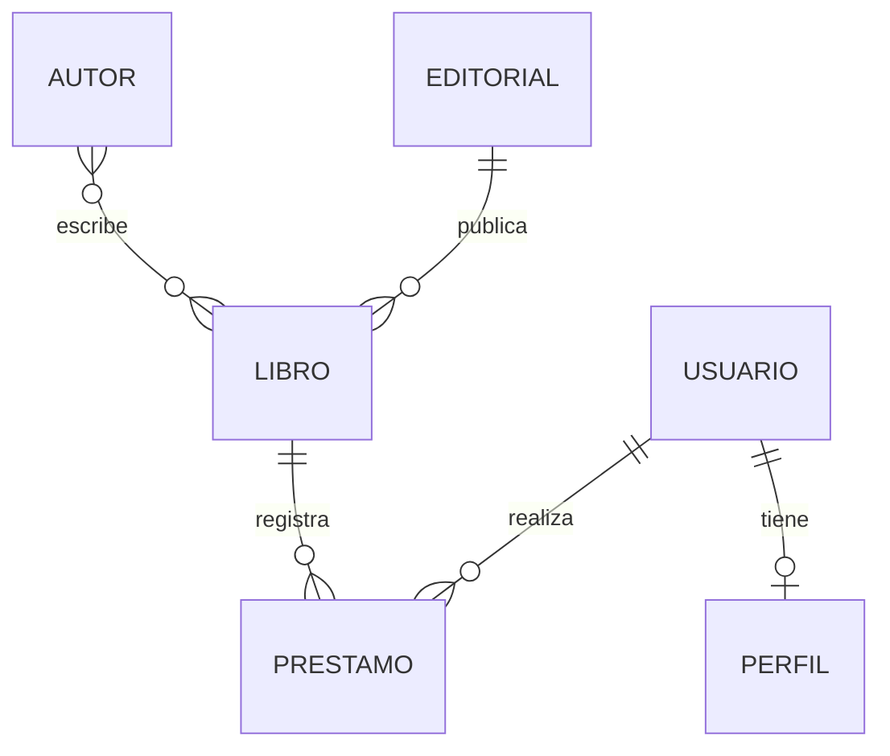

# Bloque 10. Práctica integradora: gestión de una biblioteca

## Objetivo

Desarrollar y verificar una aplicación Django que gestione **modelos relacionados** mediante migraciones, operaciones CRUD, consultas ORM, restricciones, transacciones y el panel de administración.

## Enunciado

Partiendo del proyecto `biblioteca`, completa una aplicación de gestión de libros y préstamos. Puedes reutilizar los modelos y funciones de los bloques anteriores, pero debes comprobar que todas las partes funcionan conjuntamente.

### Parte A. Modelos y relaciones

La aplicación debe incluir:

- `Autor`: nombre, apellidos y otros datos relevantes.
- `Editorial`: nombre y datos de contacto.
- `Libro`: título, ISBN único, precio no negativo, disponibilidad y fecha de publicación.
- `Perfil`: relación uno a uno con el usuario de Django.
- `Prestamo`: libro, usuario, fecha de préstamo y fecha de devolución opcional.

Relaciones requeridas:

Cada libro pertenece a una editorial, puede tener varios autores y puede figurar en varios préstamos históricos, pero **no puede tener más de un préstamo activo**.

### Parte B. Migraciones

1. Comprueba que los modelos tienen los campos y restricciones solicitados.
2. Genera las migraciones pendientes con `makemigrations`.
3. Aplica las migraciones con `migrate`.
4. Verifica su estado con `showmigrations`.

### Parte C. Operaciones CRUD

Implementa y demuestra, mediante Django Shell o funciones Python invocadas desde él:

1. Crear una editorial y dos autores.
2. Crear tres libros y asignarles sus autores.
3. Recuperar un libro por su ISBN.
4. Modificar el precio de un libro.
5. Eliminar un libro que no tenga préstamos asociados.

### Parte D. Consultas ORM

Resuelve estas consultas sin escribir SQL directamente:

1. Listar todos los libros disponibles, ordenados por título.
2. Buscar libros cuyo título contenga un texto introducido por el usuario.
3. Mostrar libros de una editorial concreta.
4. Recuperar los libros escritos por un autor determinado.
5. Calcular el precio medio de los libros.
6. Obtener el número de libros de cada editorial.
7. Listar los préstamos activos.

Usa `filter()`, `order_by()`, consultas a relaciones, `aggregate()` y `annotate()` donde corresponda.

### Parte E. Integridad y transacciones

Implementa las operaciones `prestar_libro(libro_id, usuario)` y `devolver_libro(prestamo_id)`.

- Al prestar un libro disponible, debe registrarse el préstamo y actualizarse su disponibilidad.
- No debe admitirse un préstamo si el libro no está disponible.
- Al devolverlo, debe registrarse la devolución y actualizarse la disponibilidad.
- No debe permitirse devolver dos veces el mismo préstamo.
- Las modificaciones relacionadas deben ejecutarse dentro de `transaction.atomic()`.
- Comprueba con una prueba controlada que una excepción provoca un rollback.

**Nota técnica:** SQLite no implementa bloqueo de filas con `select_for_update()`. Para una aplicación concurrente real, revisa las garantías de integridad y el comportamiento del gestor utilizado; `atomic()` por sí solo no evita todas las condiciones de carrera.

### Parte F. Panel de administración

1. Registra los modelos necesarios en `catalogo/admin.py`.
2. Personaliza el listado de libros con `list_display`.
3. Incorpora búsquedas por título e ISBN.
4. Añade filtros por editorial y disponibilidad.
5. Comprueba que puedes crear y modificar registros desde Admin.

### Parte G. Gestor de base de datos

Incluye en el proyecto una explicación breve de cómo configurar `DATABASES` para SQLite y PostgreSQL. No incluyas credenciales reales. Si dispones de un servidor PostgreSQL, comprueba la aplicación de las migraciones en una base de datos vacía.

## Organización sugerida del trabajo

| Fase | Tiempo |
|---|---:|
| Revisión de modelos y migraciones | 20 min |
| CRUD y consultas ORM | 35 min |
| Préstamos, transacciones y comprobaciones | 35 min |
| Administración, verificación y entrega | 30 min |
| **Total** | **120 min** |

## Entrega

Sube el proyecto Django a GitHub o entrega el enlace del repositorio siguiendo las indicaciones del profesor. Debe incluir:

- Código de la aplicación `catalogo` y configuración del proyecto.
- Archivos de migración.
- `requirements.txt` con las dependencias necesarias.
- Un `README.md` con instrucciones para instalar, migrar y ejecutar el proyecto.
- Un archivo o documento con las consultas ORM realizadas y sus resultados.
- Evidencias de operaciones CRUD, préstamos, rollback y panel de administración.

**No incluyas:** entorno virtual, contraseñas, archivos `.env`, datos personales reales ni la base de datos con información sensible.

## Lista de comprobación

- [ ] He definido correctamente los modelos y los tres tipos de relaciones.
- [ ] Las migraciones se aplican sin errores.
- [ ] Puedo crear, recuperar, modificar y eliminar registros.
- [ ] Las consultas ORM devuelven los resultados esperados.
- [ ] Los préstamos y devoluciones mantienen los datos consistentes.
- [ ] He comprobado el rollback de una transacción.
- [ ] El panel de administración permite gestionar los modelos.
- [ ] El proyecto contiene instrucciones para reproducir la instalación.

## Preguntas finales

1. ¿Qué ventajas aporta el ORM frente a escribir SQL en cada operación?
2. ¿Por qué las migraciones forman parte del código del proyecto?
3. ¿Qué diferencias existen entre `ForeignKey`, `ManyToManyField` y `OneToOneField`?
4. ¿Por qué una operación de préstamo necesita una transacción?
5. ¿Qué pasos hay que seguir para utilizar PostgreSQL en lugar de SQLite?
