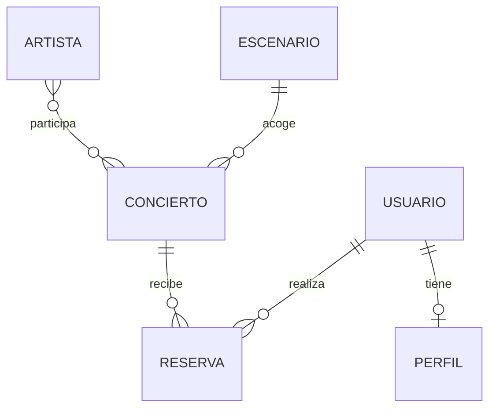
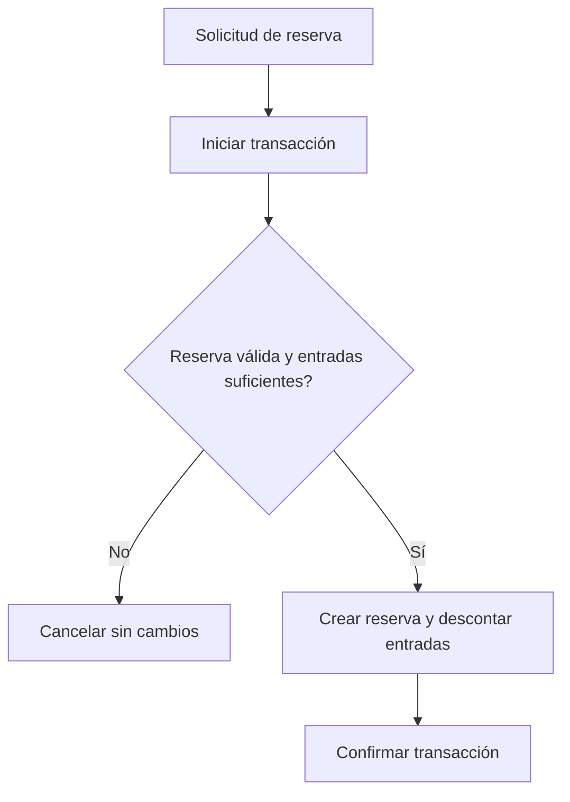

# Práctica integradora UT4. Festival de música

**Módulo:** Desarrollo Web en Entorno Servidor (DWES)  
**Curso:** 2.º DAW  
**Unidad:** UT4. Persistencia: bases de datos y ORM  
**Duración estimada:** 3 horas  
**Tecnologías:** Python, Django, SQLite y PostgreSQL.

## 1. Introducción

Una empresa organizadora de festivales de música necesita desarrollar una aplicación web que permita gestionar los artistas participantes, los escenarios, los conciertos programados y la venta de entradas.

La aplicación deberá almacenar toda la información en una base de datos relacional, permitiendo realizar consultas, modificar los datos y garantizar la integridad de la información almacenada. Se deberá prestar especial atención a la venta de entradas, evitando que se supere el aforo máximo de los conciertos.

El objetivo es desarrollar la capa de persistencia utilizando el ORM de Django y aplicar los conocimientos adquiridos a lo largo de la unidad.

## 2. Creación y configuración del proyecto

Crea un nuevo proyecto Django denominado `musicfest` y una aplicación denominada `festival`. Configura inicialmente SQLite, organiza los archivos y registra la aplicación en Django.

## 3. Diseño del modelo de datos

### 3.1. Artista

| Campo | Descripción |
|---|---|
| Nombre | Nombre artístico único |
| País | País de procedencia |
| Género musical | Género musical principal |
| Fecha de creación | Inicio de actividad |
| Caché | Importe económico por actuación |
| Activo | Indica si participa actualmente |

### 3.2. Escenario

| Campo | Descripción |
|---|---|
| Nombre | Nombre único del escenario |
| Ubicación | Localización dentro del recinto |
| Aforo | Número máximo de asistentes |
| Cubierto | Indica si dispone de cubierta |

### 3.3. Concierto

| Campo | Descripción |
|---|---|
| Nombre | Nombre del concierto |
| Fecha y hora | Momento de inicio |
| Duración | Duración en minutos |
| Precio | Precio de una entrada |
| Escenario | Escenario donde se celebra |
| Artistas | Artistas que participan |
| Entradas disponibles | Número de entradas restantes |
| Cancelado | Indica si ha sido cancelado |

Un concierto puede contar con varios artistas y un artista puede participar en diferentes conciertos.

### 3.4. Perfil de asistente

| Campo | Descripción |
|---|---|
| Usuario | Usuario del sistema de autenticación de Django |
| DNI | Documento de identidad único |
| Teléfono | Número de contacto |
| Fecha de nacimiento | Fecha de nacimiento |
| Localidad | Localidad de residencia |

Utiliza el modelo de usuarios proporcionado por Django.

### 3.5. Reserva

| Campo | Descripción |
|---|---|
| Localizador | Código único de la reserva |
| Usuario | Usuario que realiza la reserva |
| Concierto | Concierto reservado |
| Fecha de reserva | Fecha y hora de creación |
| Número de entradas | Cantidad de entradas reservadas |
| Importe total | Importe económico de la reserva |
| Estado | Confirmada o cancelada |

Un usuario puede realizar varias reservas y cada concierto puede tener múltiples reservas asociadas.

## 4. Relaciones entre modelos



Utiliza `OneToOneField`, `ForeignKey` y `ManyToManyField`. Configura `on_delete` y `related_name`, justificando las decisiones tomadas.

## 5. Restricciones e integridad de los datos

- No pueden existir dos artistas ni dos escenarios con el mismo nombre dentro de su respectivo modelo.
- El aforo y la duración deben ser mayores que cero.
- El caché y el precio no pueden ser negativos.
- Las entradas disponibles no pueden ser negativas ni superar el aforo del escenario.
- No pueden existir dos perfiles con el mismo DNI.
- El localizador de cada reserva debe ser único.
- Una reserva debe contener al menos una entrada.
- No se podrá eliminar un concierto que tenga reservas asociadas.

Distingue entre las restricciones que pueden establecerse directamente en la base de datos y las que requieren lógica adicional en la aplicación.

## 6. Migraciones

1. Genera las migraciones correspondientes.
2. Aplica las migraciones.
3. Comprueba su estado.
4. Introduce algunos datos de prueba y añade posteriormente un campo `descripcion` a `Concierto`.
5. Genera y aplica una nueva migración.
6. Comprueba que los datos anteriores no se han perdido.

## 7. Carga inicial de datos

| Entidad | Registros mínimos |
|---|---:|
| Artistas | 8 |
| Escenarios | 3 |
| Conciertos | 6 |
| Usuarios | 5 |
| Perfiles | 5 |
| Reservas | 10 |

Incluye conciertos con varios artistas, artistas que participen en varios conciertos, conciertos gratuitos y de pago y reservas canceladas. Mantén la coherencia entre las reservas confirmadas y las entradas disponibles.

## 8. Operaciones CRUD

Utilizando Django Shell o funciones Python invocadas desde él:

1. Crear un nuevo artista.
2. Crear un nuevo escenario.
3. Crear un concierto y asignarle varios artistas.
4. Recuperar un artista por su identificador.
5. Recuperar una reserva por su localizador.
6. Modificar el precio de un concierto.
7. Cambiar el escenario de un concierto sin reservas, ajustando su disponibilidad.
8. Añadir un artista a un concierto existente.
9. Eliminar la participación de un artista sin eliminar al artista.
10. Eliminar un concierto sin reservas.
11. Intentar eliminar un concierto con reservas y comprobar el comportamiento.

Todas las operaciones deberán realizarse mediante el ORM, sin SQL directo.

## 9. Consultas mediante el ORM

### 9.1. Consultas básicas

1. Mostrar todos los artistas ordenados alfabéticamente.
2. Mostrar únicamente los artistas activos.
3. Obtener los artistas de un determinado país.
4. Buscar artistas cuyo nombre contenga una cadena de texto.
5. Mostrar los conciertos cuyo precio esté comprendido entre 20 y 50 euros.
6. Mostrar los conciertos gratuitos.
7. Mostrar los conciertos con entradas disponibles y no cancelados.
8. Mostrar los conciertos ordenados por fecha y hora.

### 9.2. Consultas sobre modelos relacionados

9. Mostrar los conciertos de un escenario determinado.
10. Mostrar los artistas de un concierto.
11. Obtener los conciertos en los que participa un artista.
12. Mostrar las reservas de un usuario.
13. Mostrar los usuarios con alguna reserva confirmada para un concierto determinado, sin duplicados.
14. Mostrar los conciertos con artistas de un determinado país.
15. Mostrar los artistas que no participan en ningún concierto.

### 9.3. Consultas de agregación y agrupación

16. Calcular el precio medio de los conciertos.
17. Obtener el precio del concierto más caro y del más barato.
18. Calcular el aforo total de todos los escenarios.
19. Obtener el número de conciertos de cada escenario.
20. Obtener el número de conciertos en los que participa cada artista.
21. Calcular el número total de entradas reservadas y confirmadas por concierto.
22. Calcular la recaudación de cada concierto, excluyendo reservas canceladas.
23. Obtener los tres conciertos con más entradas reservadas y confirmadas.
24. Mostrar los usuarios con más de una reserva confirmada.

Utiliza `filter()`, `exclude()`, `get()`, `order_by()`, `distinct()`, `aggregate()` y `annotate()` cuando corresponda.

## 10. Transacciones

### 10.1. Realizar una reserva

Implementa la función:

```python
realizar_reserva(usuario_id, concierto_id, cantidad)
```

1. Recuperar el usuario y el concierto.
2. Comprobar que el concierto no está cancelado.
3. Comprobar que la cantidad es válida.
4. Verificar que existen suficientes entradas disponibles.
5. Calcular el importe total.
6. Generar un localizador único.
7. Crear la reserva confirmada.
8. Descontar las entradas reservadas.

Todas las modificaciones deberán realizarse dentro de una misma transacción. Si se produce un error, ninguna modificación deberá quedar almacenada. Evita que dos reservas simultáneas superen el aforo disponible.



### 10.2. Cancelar una reserva

```python
cancelar_reserva(reserva_id)
```

Recupera la reserva, comprueba que está confirmada, cambia su estado a cancelada y devuelve al concierto las entradas correspondientes. No permitas cancelar dos veces la misma reserva. Realiza la operación mediante una transacción.

### 10.3. Comprobación del funcionamiento

| Prueba | Resultado esperado |
|---|---|
| Reservar 2 entradas disponibles | Reserva confirmada |
| Reservar más entradas de las disponibles | Operación rechazada |
| Reservar 0 entradas | Operación rechazada |
| Reservar para un concierto cancelado | Operación rechazada |
| Cancelar una reserva confirmada | Entradas recuperadas |
| Cancelar una reserva ya cancelada | Operación rechazada |
| Provocar un error durante una transacción | Sin cambios parciales |
| Dos reservas simultáneas para las últimas entradas | No superar el aforo |

## 11. Panel de administración de Django

Registra y personaliza todos los modelos.

| Modelo | Personalización requerida |
|---|---|
| Artista | Búsqueda por nombre y filtros por país, género y estado |
| Escenario | Visualización de nombre, ubicación y aforo |
| Concierto | Filtros por fecha, escenario y estado |
| Perfil | Búsqueda por DNI y usuario |
| Reserva | Búsqueda por localizador y filtros por estado y concierto |

Utiliza `list_display`, `list_filter`, `search_fields`, `ordering`, `filter_horizontal` y `readonly_fields`. Incorpora un `InlineModelAdmin` para consultar las reservas de un concierto.

Protege los campos que intervienen en la disponibilidad de entradas frente a modificaciones manuales incoherentes. La creación y cancelación de reservas deberá respetar la lógica transaccional.

## 12. Configuración de PostgreSQL

Una vez comprobado el funcionamiento con SQLite, configura PostgreSQL. Instala el controlador necesario, crea la base de datos, modifica la configuración, aplica las migraciones y carga nuevamente los datos de prueba.

Comprueba las consultas y operaciones transaccionales, especialmente las reservas simultáneas sobre PostgreSQL. No incluyas contraseñas en GitHub.

## 13. Entrega de la práctica

Entrega un repositorio de GitHub con, como mínimo, la siguiente estructura:

```text
musicfest/
├── manage.py
├── requirements.txt
├── README.md
├── .gitignore
├── musicfest/
│   ├── settings.py
│   └── urls.py
├── festival/
│   ├── migrations/
│   ├── models.py
│   ├── admin.py
│   ├── services.py
│   └── consultas.py
└── documentacion/
    ├── modelo-datos.md
    ├── operaciones-crud.md
    ├── consultas-orm.md
    └── pruebas.md
```

El `README.md` deberá explicar el objetivo, los requisitos de instalación, la configuración de la base de datos y los pasos para ejecutar el proyecto. Documenta las consultas, sus resultados y las evidencias de las pruebas de integridad y transacciones.


No se requiere desarrollar formularios, vistas basadas en clases ni una API REST, ya que corresponden a unidades posteriores.
